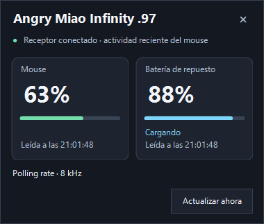

# AM Infinity .97 Battery Tray

Monitor de las dos baterías del Angry Miao AM Infinity .97 conectado por su receptor USB de 2,4 GHz. Aplicación de bandeja en C# y WinForms para Windows x64. El ejecutable autónomo se distribuye sin instalador, funciona sin Internet y contiene el runtime .NET 10. Usa las versiones de Windows 10 y 11 [compatibles con .NET 10](https://learn.microsoft.com/dotnet/core/install/windows#supported-versions).

[Descargar para Windows x64](https://github.com/SebastianFredesC/am-infinity-97-tray/releases/latest)

## Uso

1. Conecta un receptor .97 y ejecuta **AMInfinity97Tray.exe**. Busca el icono de batería en el área de notificaciones, incluida la sección de iconos ocultos.
2. Mueve el .97 para obtener la primera lectura. Pasa el cursor sobre el icono para ver las dos baterías y la hora. Haz clic para abrir el panel oscuro con los niveles y sus barras. El panel se cierra al hacer clic fuera o pulsar Esc.
3. Usa **Actualizar ahora** en el panel para consultar ambas baterías con actividad reciente del .97 y al menos 5 segundos desde el intento anterior. Si el mouse está en reposo, la solicitud espera a que vuelvas a moverlo. El menú contextual contiene el intervalo automático, las notificaciones, el inicio con Windows y la pausa para reservar el receptor a AM Master.
4. Elige **Idioma → English** en el menú contextual para usar la app en inglés. Para volver al español, elige **Language → Español**. La elección se guarda para la próxima vez que abras la app.
5. Elige **Polling rate → 1, 2, 4 u 8 kHz** en el menú contextual. El panel muestra el valor leído del mouse. Si falta actividad reciente del .97, hay cinco segundos para moverlo antes de cancelar la solicitud. Se envía un solo cambio y se vuelve a leer el ajuste para verificarlo.

El icono de batería representa el nivel de la batería instalada. Verde para más de 30%, amarillo de 11 a 30%, rojo de 0 a 10% y gris mientras se desconoce el valor. El panel conserva la última lectura tras un error o una desconexión e indica cuándo es anterior. Si el receptor informa de una batería de repuesto ausente, el panel indica «No instalada». Las alertas predeterminadas son al 20% y al 5%, con repetición solo tras recuperación o cuando el nivel pasa de bajo a crítico. Una batería que está cargando queda exenta de avisos. Windows controla la presentación de las notificaciones.

## Configuración local

El inicio con Windows está desactivado por defecto y usa la clave de inicio de sesión del usuario actual. Si mueves el ejecutable, vuelve a activar esa opción desde la nueva ubicación. Las demás preferencias se guardan en %LOCALAPPDATA%\AMInfinity97Tray\preferences.json al realizar el primer cambio. Para ajustar valores avanzados, cierra la aplicación antes de editar ese archivo.

| Propiedad | Valor inicial | Descripción |
| --- | ---: | --- |
| Language | es | Idioma de la interfaz. Usa es para español o en para inglés. |
| Interval | 60 | Segundos entre intentos automáticos de batería. Rango de 60 a 3600. |
| Notifications | true | Alertas para lecturas nuevas. |
| StabilizationMs | 350 | Espera tras la entrada física. Rango de 200 a 1000 ms. |
| ReconnectStartSeconds | 5 | Espera inicial para buscar un receptor ausente. Se duplica con cada fallo. |
| ReconnectMaxSeconds | 120 | Límite de la espera de descubrimiento. |
| BusyStartSeconds | 120 | Pausa inicial tras un error de acceso o uso compartido. Se duplica con cada fallo. |
| BusyMaxSeconds | 900 | Límite de la pausa por acceso. |
| LowPercent | 20 | Umbral bajo. |
| CriticalPercent | 5 | Umbral crítico, inferior al umbral bajo. |

## Protocolo y suspensión

El tray de lwYeo fue la referencia para el inicio sin ventana y el menú. Las dos consultas de batería se basan en aminf-cli y en el configurador oficial. La aplicación selecciona exclusivamente **0E8D:0703**, colección **0xFF13**. Si el descriptor anuncia el informe de características **0x14**, se usa ese canal para ambas baterías. En su ausencia se admite el canal de salida **0x06** y entrada **0x07**. El .100 utiliza otros identificadores y otro protocolo. El código de referencia identifica **0E8D:0880** y **35A1:0035** como variantes de USB directo del .97. Esta aplicación cubre un único receptor de 2,4 GHz. [Tray de lwYeo](https://github.com/lwYeo/Angry-Miao-Infinity-Mouse-Battery-Tray) · [aminf-cli, MIT](https://github.com/TheMasterDingo/aminf-cli) · [Configurador oficial](https://ammaster.angrymiao.com/mouse/devices)

| Pregunta | Evidencia y comportamiento de la aplicación |
| --- | --- |
| ¿El receptor conserva el porcentaje del mouse dormido? | La referencia no documenta una caché accesible en ese estado. La aplicación conserva su propia última lectura en memoria y muestra la hora. |
| ¿Leer despierta el mouse o cambia el momento de suspensión? | Efecto sin medición física. En el transporte por informes de características, la consulta del mouse se dirige a **0x80**. En el transporte por entrada y salida, el receptor usa su ruta predeterminada **0x00**. Ambos exigen entrada auténtica y reciente del receptor. |
| ¿Puede leerse el repuesto por separado? | El comando del repuesto se dirige al receptor local **0x00**. Su efecto energético durante el reposo sigue pendiente de pruebas. Solo se envía después de una lectura válida del mouse y dentro de la misma ventana de actividad. |
| ¿Se puede saber por HID si está dormido? | Las dos consultas de batería no ofrecen un indicador de suspensión confirmado. La ausencia de movimiento o botones es un indicio, y un timeout se muestra como falta de respuesta. Acceso denegado, respuesta inválida y receptor retirado tienen estados propios. |
| ¿Qué se envía al dispositivo? | Las solicitudes de batería **0x30CF** y **0x300F** y, por el canal de características **0x14**, la consulta de polling rate **0x3011**. La selección explícita del usuario en el menú envía **0x3010** una vez y consulta **0x3011** para verificar el valor. Todas estas operaciones requieren actividad reciente del .97. |

Se toma una muestra de Raw Input del receptor al hacer falta. Funciona con desplazamientos relativos y botones sin instalar un hook global. El registro de Raw Input se desactiva al recibir una muestra y una entrada de otro puntero aplaza la siguiente toma durante 250 ms. Algunos juegos o entornos pueden impedir que Windows entregue esa entrada en segundo plano. En ese caso la aplicación espera. [Raw Input en Windows](https://learn.microsoft.com/windows/win32/inputdev/about-raw-input)

El manual indica un reposo nominal de 30 s para 2,4 GHz. La aplicación usa 30 s sin actividad observada para mostrar un posible reposo. La ventana de envío es de 2,5 s desde la evidencia física, incluso tras pulsar **Actualizar ahora**. Fuera de esa ventana el monitor no abre el canal para enviar informes. Durante el reposo, los cambios USB se detectan mediante notificaciones y, si falta el receptor, se revisan propiedades que Windows conserva. [Manual del AM Infinity .97](https://device.report/manual/20456569)

### AM Master

aminf-cli advierte que AM Master o el configurador web pueden mantener el receptor abierto. La app abre el canal con acceso compartido solo durante cada ronda, da lugar a reintentos progresivos tras acceso denegado y conserva los datos previos. El protocolo no tiene un identificador de transacción que distinga dos respuestas simultáneas al mismo comando. Si ambos programas admiten abrir el canal de forma compartida, la coexistencia de las consultas requiere verificación con AM Master y la versión de firmware usados. Para una sesión de configuración, pausa el monitoreo desde el menú y reanúdalo al terminar. [Notas de acceso en aminf-cli](https://github.com/TheMasterDingo/aminf-cli#install)

## Compilar y probar

Ejecuta estos comandos desde esta carpeta con el SDK .NET 10 x64 en Windows.

~~~powershell
dotnet run --project .\tests\AMInfinity97Tray.Tests.csproj -c Release
dotnet run --project .\tests\AMInfinity97Tray.Tests.csproj -c Release -- --receptor
dotnet publish .\src\AMInfinity97Tray.csproj -c Release -r win-x64 --self-contained true -p:PublishSingleFile=true -p:IncludeNativeLibrariesForSelfExtract=true -p:DebugType=embedded -o .\dist\win-x64
~~~

Las pruebas automatizadas usan informes sintéticos y cubren porcentajes, ventanas de actividad, alertas y validación de tramas. La prueba opcional con **--receptor** comprueba el descubrimiento de Windows sin enviar informes HID. El modo **--diagnostico** de la aplicación conserva hasta 256 eventos en memoria y solo escribe al usar **Guardar diagnóstico…**. [Procedimiento con el mouse físico](PRUEBAS-HARDWARE.md)

En Windows 10 22H2, una prueba en hardware con el mouse y el receptor en firmware **v1.8.4** obtuvo ambos porcentajes y el estado de carga del repuesto mediante el informe 0x14. Ese receptor también anuncia 0x06 y 0x07, canal por el que las pruebas de batería agotaron el tiempo de espera. El procedimiento con el mouse físico describe cómo verificar la suspensión y el selector de polling rate.
